# 4. System Diagrams

All diagrams are written in Mermaid and render in GitHub, Visual Studio Code (Markdown preview with Mermaid support), and the Mermaid Live Editor. Each diagram reflects the implementation described in Document 3.

Notation for the data flow diagrams: rectangles are external entities, rounded nodes are processes, and cylinders are data stores.

---

## 4.1 Context Diagram

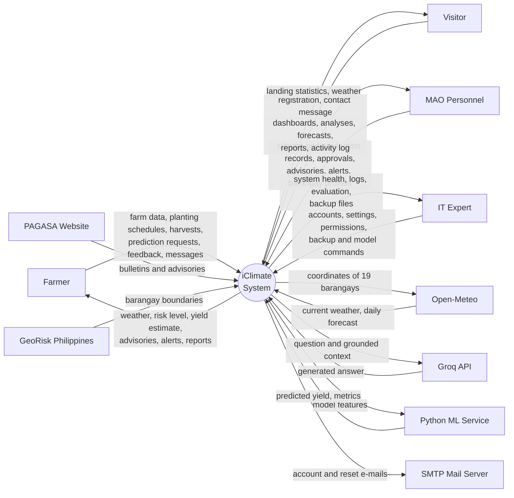

---

## 4.2 Data Flow Diagram: Level 0

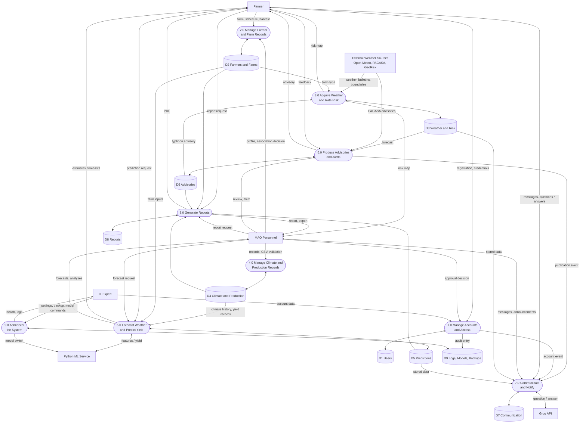

**Data stores and their tables**

| Store | Tables |
|---|---|
| D1 Users | `users`, `sessions`, `password_reset_tokens`, `mao_user_barangays` |
| D2 Farmers and Farms | `farmer_profiles`, `farms`, `farm_boundaries`, `farmer_planting_schedules`, `farmer_organizations`, `farmer_organization_members`, `barangay_profiles`, `rice_varieties` |
| D3 Weather and Risk | `external_weather_data`, `weather_fetch_logs`, `heatmap_areas` |
| D4 Climate and Production | `climate_records`, `rice_productions`, `historical_rice_productions` |
| D5 Predictions | `monthly_weather_predictions`, `yield_predictions`, `yield_prediction_requests`, `municipal_yield_predictions`, `yield_prediction_feedback`, `weather_impact_analyses`, `analytics_runs` |
| D6 Advisories | `planting_advisories`, `advisory_rules`, `advisory_feedback`, `typhoon_safety_responses` |
| D7 Communication | `notifications`, `conversations`, `conversation_messages`, `feed_posts`, `feed_media`, `feed_comments`, `feed_reactions`, `a_i_chats`, `ai_*`, `knowledge_base`, `chatbot_responses` |
| D8 Reports | `reports` |
| D9 Logs, Models, Backups | `system_logs`, `mao_activity_logs`, `ml_models`, `backup_verifications`, `maintenance_records`, `scheduled_task_runs`, `farmer_survey_responses`, `model_feedback_decisions`, settings file |

---

## 4.3 Data Flow Diagrams: Level 1

### 4.3.1 Process 1.0: Manage Accounts and Access

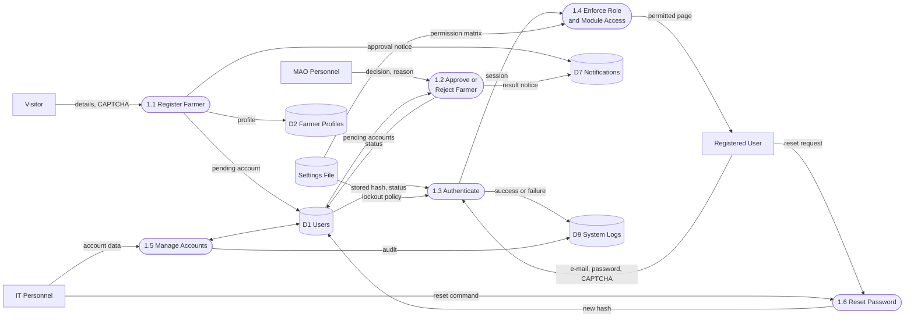

### 4.3.2 Process 3.0: Acquire Weather and Rate Risk

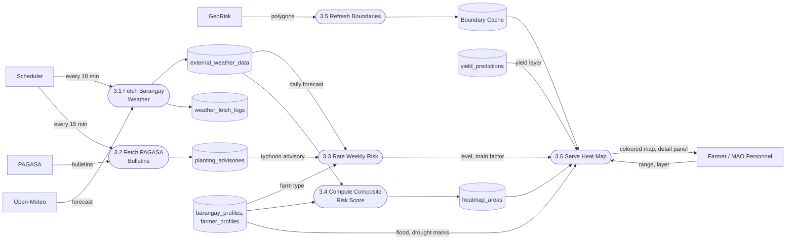

### 4.3.3 Process 5.0: Forecast Weather and Predict Yield

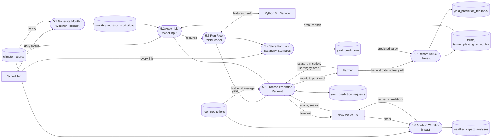

### 4.3.4 Process 6.0: Produce Advisories and Alerts

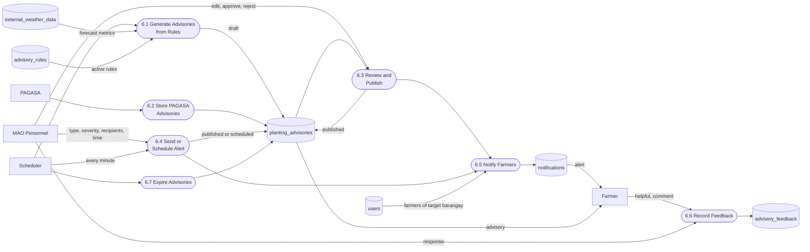

### 4.3.5 Process 9.0: Administer the System

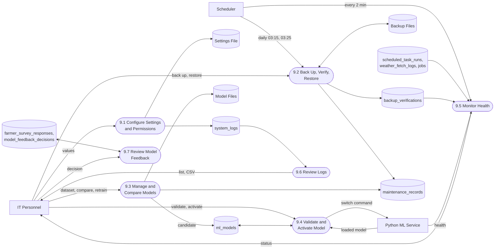

---

## 4.4 Use Case Diagrams

Mermaid has no native use case notation; the diagrams below use actors as rectangles and use cases as rounded nodes within a system boundary.

### 4.4.1 Farmer

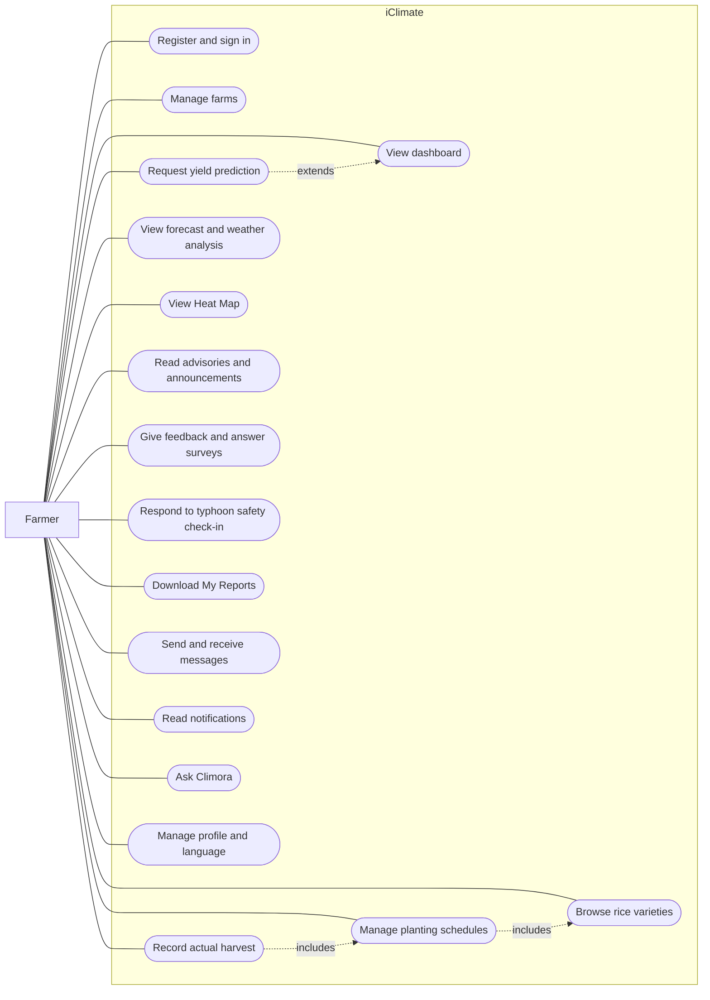

### 4.4.2 MAO Personnel and Municipal Agriculturist

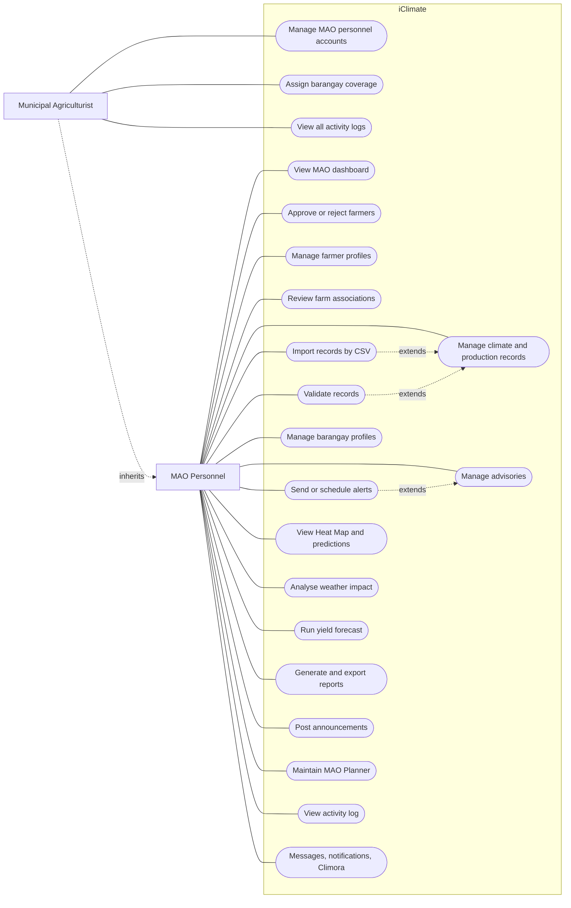

### 4.4.3 IT Personnel

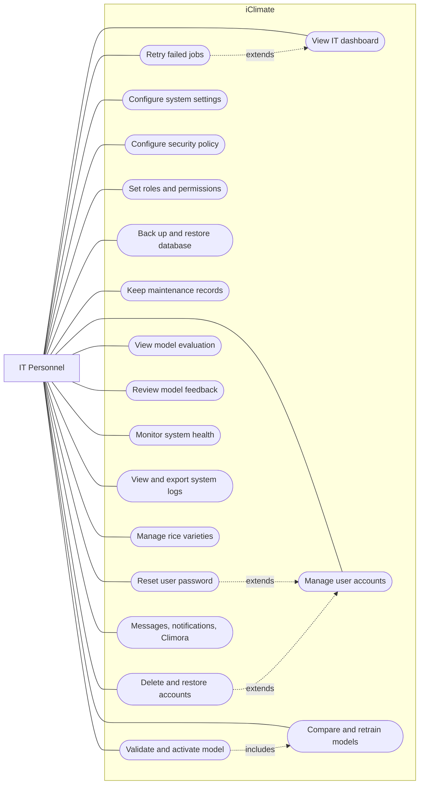

---

## 4.5 Flowcharts

### 4.5.1 Sign-in

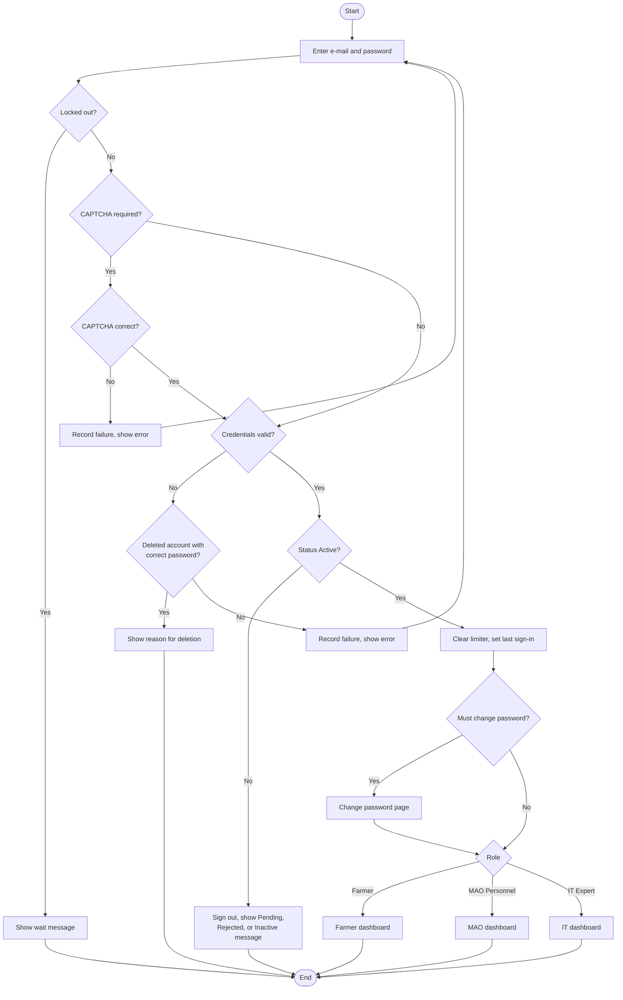

### 4.5.2 Farmer registration and approval

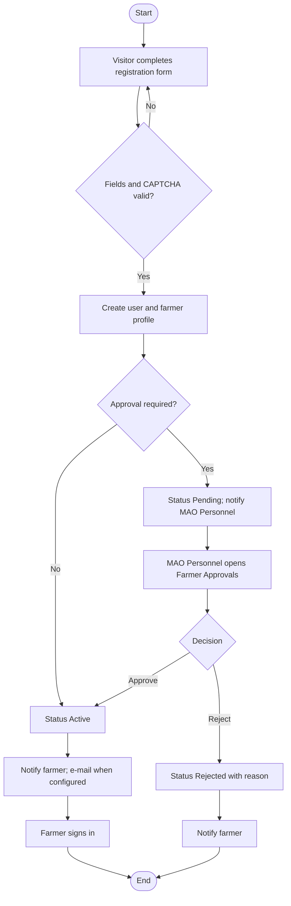

### 4.5.3 Rice yield prediction

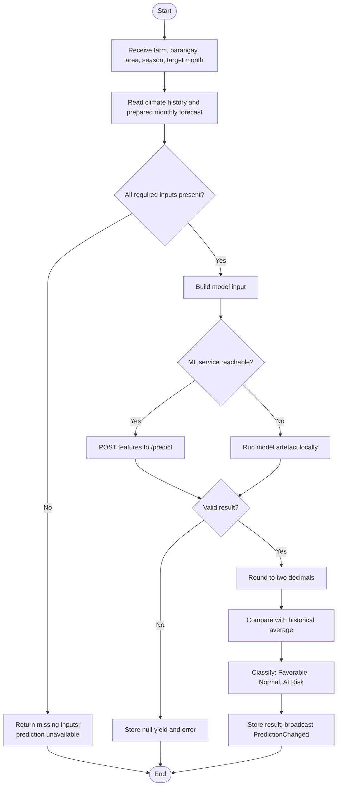

### 4.5.4 Weekly risk rating of a barangay

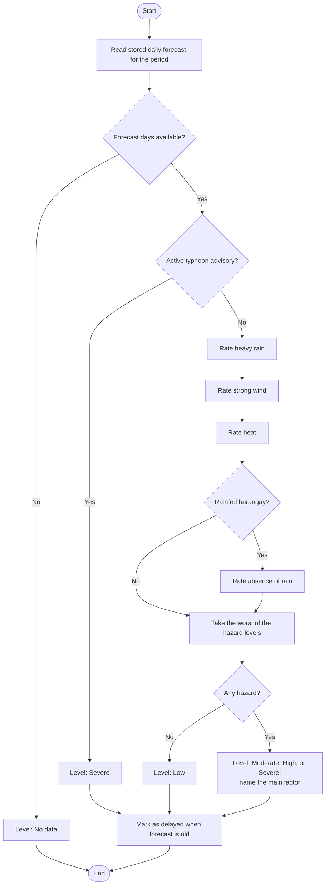

### 4.5.5 Advisory life cycle

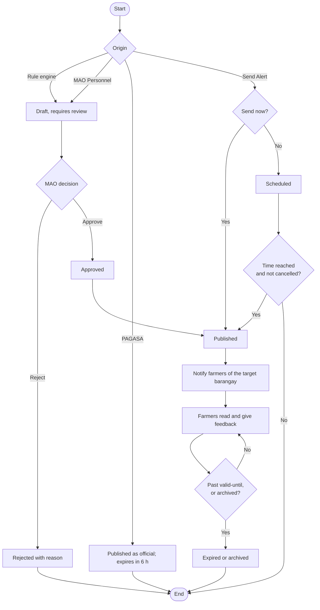

### 4.5.6 Climora answer routing

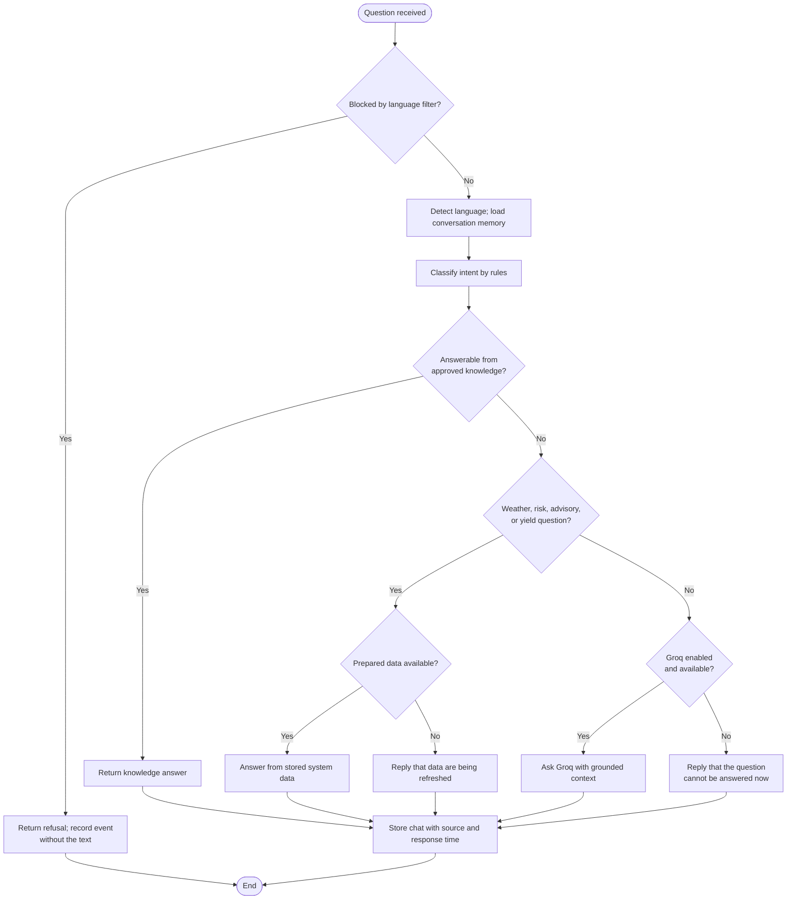

### 4.5.7 Model activation

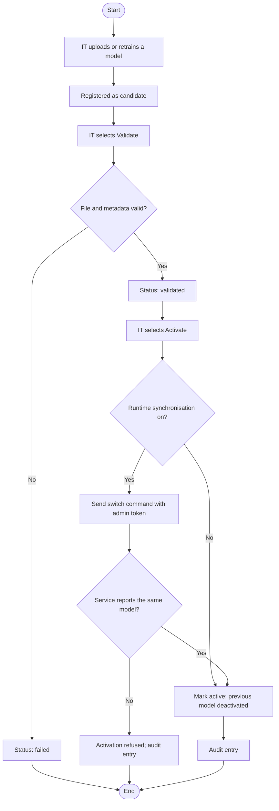

---

## 4.6 Entity Relationship Diagrams

The schema contains sixty-eight tables. For legibility, the ERD is presented in four subject areas. Attributes are abbreviated to keys and principal fields; the complete column list is in the migrations.

### 4.6.1 Users, farmers, and farms

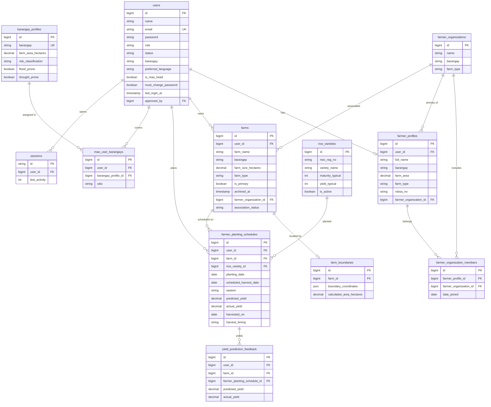

### 4.6.2 Climate, weather, risk, and prediction

```mermaid
erDiagram
    users ||--o{ yield_prediction_requests : "requests"
    users ||--o{ weather_impact_analyses : "saves"
    users ||--o{ weather_forecast_feedback : "rates"
    users ||--o{ analytics_runs : "starts"
    farms ||--o{ yield_predictions : "estimated for"
    monthly_weather_predictions ||--o{ weather_forecast_feedback : "rated by"
    external_weather_data ||--o{ planting_advisories : "supports"

    climate_records {
        bigint id PK
        date record_date
        decimal rainfall
        decimal temperature
        decimal humidity
        decimal wind_speed
        string season
        string source
        timestamp verified_at
        bigint verified_by FK
    }
    rice_productions {
        bigint id PK
        string barangay
        string season
        year year
        string irrigation_type
        decimal area_hectares
        decimal area_harvested_hectares
        decimal total_production
        decimal yield_per_hectare
        timestamp verified_at
    }
    historical_rice_productions {
        bigint id PK
        string barangay
        string season
        int season_year
        decimal area_planted_hectares
        decimal average_yield_t_per_hectare
        decimal total_production_tons
    }
    external_weather_data {
        bigint id PK
        string source
        string location_name
        date forecast_date
        decimal temperature_max
        decimal rainfall_mm
        decimal wind_speed
        json raw_response
        timestamp fetched_at
    }
    heatmap_areas {
        bigint id PK
        string barangay UK
        string risk_level
        decimal risk_score
        decimal predicted_yield
        json risk_components
        timestamp risk_computed_at
    }
    monthly_weather_predictions {
        bigint id PK
        int prediction_year
        int prediction_month
        decimal rainfall
        decimal tmax
        decimal tmin
        decimal humidity
        string weather_model
        string status
    }
    yield_predictions {
        bigint id PK
        string scope
        string subject_key
        bigint farm_id FK
        string barangay
        decimal predicted_yield
        string season
        string period
        string model_version
        json model_input
    }
    yield_prediction_requests {
        bigint id PK
        bigint user_id FK
        string scope
        string barangay
        string season
        decimal area_hectares
        string status
        decimal predicted_yield
        decimal historical_average
        string impact_level
    }
    municipal_yield_predictions {
        bigint id PK
        int year
        int month
        decimal predicted_yield
        decimal actual_yield
        string split
        string model
    }
    weather_impact_analyses {
        bigint id PK
        bigint created_by FK
        json filters
        json results
        string strongest_variable
        string impact_level
    }
    weather_forecast_feedback {
        bigint id PK
        bigint user_id FK
        bigint monthly_weather_prediction_id FK
        date forecast_date
        string accuracy
    }
    analytics_runs {
        bigint id PK
        uuid uuid
        string type
        string status
        bigint requested_by FK
        json input
        json result
    }
    ml_models {
        bigint id PK
        string purpose
        string name
        string version
        string file_path
        decimal mae
        decimal rmse
        string status
        boolean is_active
    }
    users {
        bigint id PK
    }
    farms {
        bigint id PK
    }
    planting_advisories {
        bigint id PK
    }
```

### 4.6.3 Advisories and communication

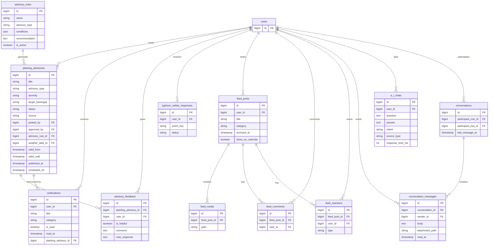

### 4.6.4 Administration, audit, and AI knowledge

```mermaid
erDiagram
    users ||--o{ system_logs : "performs"
    users ||--o{ mao_activity_logs : "performs"
    users ||--o{ mao_activities : "plans"
    users ||--o{ reports : "generates"
    users ||--o{ maintenance_records : "performs"
    users ||--o{ farmer_survey_responses : "answers"
    users ||--o{ model_feedback_decisions : "decides"
    users ||--o{ ai_moderation_events : "triggers"
    ai_knowledge_topics ||--o{ ai_terms : "groups"
    ai_knowledge_topics ||--o{ ai_faqs : "groups"
    ai_terms ||--o{ ai_synonyms : "has"
    planting_advisories ||--o{ farmer_survey_responses : "about"
    yield_prediction_requests ||--o{ farmer_survey_responses : "about"

    system_logs {
        bigint id PK
        bigint user_id FK
        string action
        text details
    }
    mao_activity_logs {
        bigint id PK
        bigint user_id FK
        string action
        string record_type
        bigint record_id
        string barangay
    }
    mao_activities {
        bigint id PK
        bigint user_id FK
        string activity_type
        date starts_on
        date ends_on
    }
    reports {
        bigint id PK
        string report_type
        bigint generated_by FK
        json payload
        string status
        int version
        string series_key
    }
    maintenance_records {
        bigint id PK
        string title
        string category
        string status
        bigint performed_by FK
    }
    backup_verifications {
        bigint id PK
        string backup_filename
        string status
        timestamp verified_at
    }
    scheduled_task_runs {
        bigint id PK
        string task_name
        string status
        timestamp started_at
    }
    weather_fetch_logs {
        bigint id PK
        string provider
        string status
        int duration_ms
    }
    farmer_survey_responses {
        bigint id PK
        bigint user_id FK
        string subject
        int useful
        int accurate
        int helpful
        string model_version
        bigint reviewed_by FK
    }
    model_feedback_decisions {
        bigint id PK
        string decision
        string model_version
        bigint decided_by FK
    }
    ai_knowledge_topics {
        bigint id PK
        string slug
        string title_en
        string title_fil
    }
    ai_terms {
        bigint id PK
        bigint topic_id FK
        string term_en
        string term_fil
    }
    ai_synonyms {
        bigint id PK
        bigint term_id FK
        string synonym
    }
    ai_faqs {
        bigint id PK
        bigint topic_id FK
        string question_en
        string question_fil
    }
    ai_blocked_terms {
        bigint id PK
        string term
        string language
    }
    ai_moderation_events {
        bigint id PK
        bigint user_id FK
        string category
        boolean blocked
    }
    users {
        bigint id PK
    }
    planting_advisories {
        bigint id PK
    }
    yield_prediction_requests {
        bigint id PK
    }
```

**Tables not drawn.** Framework tables (`cache`, `cache_locks`, `jobs`, `job_batches`, `failed_jobs`, `password_reset_tokens`); legacy or retired tables (`announcements`, `usability_survey_responses`, `heatmap_area_forecasts`, `field_reports`, `rice_yield_model_comparisons`); and supporting tables (`knowledge_base`, `chatbot_responses`, `ai_blocked_patterns`, `rice_variety_imports`).

**Note on referential integrity.** Several relationships are held by barangay name (a string) and not by a foreign key: `farms.barangay`, `rice_productions.barangay`, `heatmap_areas.barangay`, `planting_advisories.target_barangay`, and `yield_predictions.barangay`. Consistency is maintained in the application by `App\Support\LianBarangays::canonicalName`.
