# iClimate Comprehensive Requirements Analysis

## 1. Purpose and method

iClimate is a role-based agricultural information and decision-support system
for Lian, Batangas. Its implemented platform combines authenticated web
workflows, MAO-managed agricultural records, climate and weather services,
rice-yield estimation, agricultural risk visualization, advisories, reports,
notifications, AI-assisted interaction, backups, and operational monitoring.

This document describes the implemented system as found in source code. It is
not a claim that every implemented calculation is scientifically valid. In
particular, the deployed rice-yield model can load and infer, but its original
training data, preprocessing definitions, target scope, and independent
evaluation evidence are incomplete. Therefore the scientific status is:

> **ACCURACY NOT VERIFIED**

Primary evidence includes:

- `app/Models/User.php` — role and account-status constants.
- `routes/web.php`, `routes/manuscript.php`, `routes/panel.php`, `routes/api.php`,
  and `routes/channels.php` — route protection and interaction boundaries.
- `app/Services/Prediction/PredictionEngine.php` and
  `app/Services/PythonService.php` — prediction orchestration and fallback.
- `python_scripts/main.py`, `rice_yield_service.py`, and `predict.py` — ML API,
  model loading, feature construction, and validation.
- `python_scripts/ml_validation.py` and `run_ml_readiness.py` — research gates.
- Feature tests under `tests/Feature` and Python tests under
  `python_scripts/tests` — executable behavior evidence.
- `docs/data-audit/phase-3-ml-dataset-methodology.md` through
  `phase-13-capstone-demo-readiness.md` — prior evidence and limitations.

## 2. System boundary and architecture

The system boundary includes the browser, Laravel application, relational
database, database queue, scheduler, queue worker, FastAPI ML service, local
model artifacts, cache, Reverb broadcast server, local storage, and configured
external providers. The existing architecture diagram is retained at
`docs/diagrams/architecture.mmd`.

### 2.1 Implemented technology boundary

| Boundary | Implemented responsibility | Evidence |
|---|---|---|
| Browser / Blade / JavaScript | Role-specific pages, forms, polling, live invalidation, maps, reports | `resources/views`, `resources/js`, `routes/*.php` |
| Laravel | Authentication, authorization, validation, workflows, services, persistence, jobs, APIs | `app/`, `routes/` |
| MariaDB/MySQL-compatible relational DB | Users, farms, climate, production, schedules, predictions, reports, advisories, logs, queue and cache tables | `database/migrations/` |
| Database queue | Prediction requests, analytics, weather/risk refreshes, notifications and broadcasts | `app/Jobs/`, `config/queue.php` |
| Scheduler | Refresh and maintenance commands, automation status | `routes/console.php`, `app/Console/Commands/` |
| FastAPI ML service | Model loading, `/health`, `/model-info`, `/predict`, monthly weather forecast, analytics | `python_scripts/main.py` |
| Model storage | Deployed `.pkl` artifacts and registry metadata | `storage/models/`, `app/Models/MlModel.php` |
| Reverb | Authenticated private channels and dashboard invalidation events | `routes/channels.php`, `app/Events/`, `app/Broadcasting/` |
| External providers | Open-Meteo weather, PAGASA advisories/historical source, map/boundary sources, optional Groq explanation, mail | `app/Services/Weather/`, `app/Services/Advisories/`, `config/services.php` |

### 2.2 Overall system flow

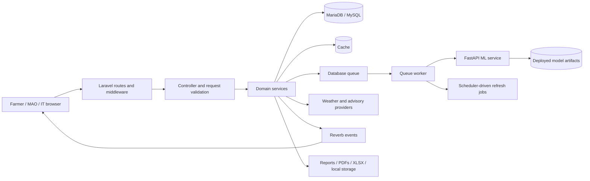

## 3. Actors, roles, and permissions

### 3.1 Verified actors

| Actor | Source-backed identity | Implemented permissions and scope |
|---|---|---|
| Farmer | `User::ROLE_FARMER` | Own profile, farms, boundaries, planting schedules, predictions, reports, advisories, feedback, surveys, conversations and own notifications. |
| MAO Personnel | `User::ROLE_MAO` | Farmer approvals, scoped farmer/farm records, agricultural and climate records, barangay profiles, schedules, forecasts, reports, advisories, alerts, personnel functions permitted by route. |
| MAO Head | `User::ROLE_MAO` plus `is_mao_head` | Municipality-wide MAO coverage and personnel-management authority where implemented. This is a flag, not a separate role constant. |
| IT Expert | `User::ROLE_IT_EXPERT` | Users, system health, logs, backups, model registry, AI knowledge administration, technical reports, model lifecycle actions, broad operational visibility. |
| Unauthenticated visitor | Guest middleware | Landing page, registration, login, password reset and public/guest-safe weather or boundary endpoints where explicitly routed. |
| Queue worker / scheduler | Process actor, not a user role | Executes queued predictions, analytics, refresh, maintenance and broadcast jobs. |
| External provider / ML service | System actor | Supplies weather/advisory data or performs inference under Laravel-controlled requests. |

The persisted role enum is limited to Farmer, MAO Personnel, and IT Expert in
`database/migrations/0001_01_01_000000_create_users_table.php`. Authorization is
primarily route middleware (`role:`), ownership checks, `MaoScope`, and private
broadcast channel callbacks. There is no general-purpose policy matrix found
that replaces these route and service checks; proposed permission governance is
listed in Section 11.

### 3.2 Broadcast authorization

`routes/channels.php` implements user-private, farm-private, conversation,
role-dashboard, barangay, MAO, and IT channels. A Farmer is limited to their
own farm/user/conversation and registered barangay; MAO scope is checked through
`MaoScope`; IT has broad technical access. `DashboardChanged` broadcasts a small
invalidation signal; clients refetch authorized data rather than receiving an
unfiltered dashboard payload.

## 4. Implemented module inventory

| Module | Main implementation | Primary data / output | Status |
|---|---|---|---|
| Authentication and accounts | `routes/auth.php`, `Auth/*`, `User` | Credentials, verification, password reset, account status | Implemented |
| Farmer onboarding and approval | `FarmerApprovalController`, `FarmerProfile`, approval routes | Pending/approved/rejected farmer accounts | Implemented |
| Farm management | `FarmController`, `Farm`, `FarmBoundary`, `ActiveFarm` | Farm identity, area, barangay, boundary and active-farm selection | Implemented |
| MAO records | `RecordImportController`, `RecordValidationController`, record models | Climate, rice production, farmer and related records with validation status | Implemented; data quality is source-dependent |
| Climate history | `ClimateHistory`, `AmbulongHistoricalClimateDataset`, `ClimateRecord` | Monthly climate inputs and station proxy history | Implemented; Lian freshness/semantic fit incomplete |
| Weather | `OpenMeteoService`, `FarmerDashboardWeatherService`, monthly forest | Current/daily/monthly weather, labels, feedback and freshness | Implemented; accuracy is not a verified superiority claim |
| Rice-yield prediction | `PredictionEngine`, `RiceYieldPredictionService`, `PythonService` | Unvalidated yield estimate, advisories, decision support | Operational; scientific accuracy unverified |
| Prediction requests | `YieldPredictionRequest`, `RunYieldPredictionRequest` | Queued/completed/failed user or MAO requests | Implemented |
| Planting schedules | `FarmerPlantingScheduleController`, `PlantingSchedulePredictionService` | Schedule, expected harvest, estimate/unavailable reason, actual harvest | Implemented |
| Heat Map / risk | `HeatMapLayerService`, `BarangayRiskMapService`, `BarangayMapLayers` | Weather, flood, drought, yield and agricultural risk layers | Implemented; yield layer is explicitly unvalidated |
| Reports and analytics | `ReportController`, `ReportExtrasController`, analytics services/jobs | Staff reports, exports, comparisons, dashboards | Implemented; provenance varies by report |
| Advisories and alerts | PAGASA/advisory services, `PlantingAdvisory`, notifications | Published, targeted and read/unread advisories | Implemented |
| AI assistant and knowledge | `AIOrchestratorService`, `PredictionService`, knowledge models | Role-aware chat, grounded answers, decision support, optional Groq explanation | Implemented; response confidence is not model accuracy |
| IT operations | `SystemHealthService`, `ItDashboardService`, logs, backups, registry | Health, jobs, security, integrity, backups and model metadata | Implemented |
| Model lifecycle | `ModelRegistryService`, `MlReadiness`, model routes | Candidate/validated/active/retired model metadata and gates | Implemented; activation remains approval-gated |
| Realtime communication | Reverb, broadcast events, retry manager, polling fallback | Dashboard/list/prediction/notification invalidation | Implemented and regression-tested |
| Messaging/community | conversations, feed posts/comments/reactions, notifications | Role-scoped communication and activity | Implemented |
| Rice varieties | `RiceVarietyController`, imports, NSIC data | Variety catalog, farm-type compatibility and harvest estimation | Implemented |
| Backup/maintenance | backup, restore-test, maintenance commands/services | Backup verification, restore checks, scheduled maintenance | Implemented; operational approval still required for destructive actions |

## 5. Workflow specifications: Actor → Input → Validation → Process → Database → Output

### 5.1 Authentication and account lifecycle

| Actor | Input | Validation | Process | Database | Output |
|---|---|---|---|---|---|
| Visitor | Registration/login/reset form | Email, password, throttles, verification, account status | Auth controllers authenticate or create pending account | `users`, password reset/session tables | Login, pending/rejected/inactive message, dashboard redirect or reset email |
| MAO | Farmer approval decision | MAO role, target account, throttle | Approve/reject and audit action | `users`, audit/activity logs, notification/email | Account status and approval notification |
| IT | User status/role/account action | IT role, numeric IDs, restore-window and throttles | Update, reset, archive/restore under admin routes | `users`, logs | Updated user/account state and audit record |

### 5.2 Farmer workflow

| Actor | Input | Validation | Process | Database | Output |
|---|---|---|---|---|---|
| Farmer | Profile/farm details | Authenticated, verified, ownership, farm area and barangay rules | Create/update profile, farm and optional boundary | `users`, `farmer_profiles`, `farms`, `farm_boundaries` | Farmer dashboard, active-farm context, validation messages |
| Farmer | Planting schedule | Date/season/farm type/area/variety validation | Save schedule, derive expected harvest, prepare or queue estimate | `farmer_planting_schedules`, `yield_predictions` where applicable | Schedule, estimate or explicit unavailable reason |
| Farmer | Yield request | Wet/Dry, Irrigated/Rainfed, Lian barangay, positive area | Queue request; worker invokes shared prediction engine | `yield_prediction_requests`, audit log, queue tables | Preparing, completed unvalidated estimate, or failed/unavailable status |
| Farmer | Climate/harvest feedback | Authenticated ownership and allowed values | Store observation/feedback for later review | `climate_records`, `farmer_survey_responses`, `yield_prediction_feedback` | Confirmation and dashboard/report update |
| Farmer | Advisory/report/chat request | Authenticated role and language | Read targeted data or submit message | Notifications, conversations, messages, report-related records | Advisory, report, answer, or unavailable response |

### 5.3 MAO workflow

| Actor | Input | Validation | Process | Database | Output |
|---|---|---|---|---|---|
| MAO | Farmer approval | MAO middleware and account ID | Approve/reject farmer and notify | `users`, logs, notifications | Updated farmer eligibility |
| MAO | Climate/production/planting import | File type, schema, row validation, provenance and record-validation routes | Preview/import, validate or unvalidate records | `climate_records`, `rice_productions`, `farmer_planting_schedules`, import/audit records | Imported or rejected rows with reasons |
| MAO | Barangay/farm management | Scope and field validation | Maintain areas, associations and assignments | `barangay_profiles`, `farms`, `mao_user_barangays`, activity logs | Scoped records and coverage view |
| MAO | Forecast/prediction request | Scope, season, farm type, area constraints | Queue shared prediction request and compare with available actuals | `yield_prediction_requests`, `yield_predictions`, `rice_productions` | Forecast history, provenance-labeled actuals, unvalidated estimate |
| MAO | Advisory/alert/report action | Role, target, approval/status and throttle checks | Publish advisory, generate/export report, notify | `planting_advisories`, `notifications`, `reports`, logs | Published advisory, report or export |

### 5.4 IT workflow

| Actor | Input | Validation | Process | Database / storage | Output |
|---|---|---|---|---|---|
| IT | System health request | IT role; read-only checks | Inspect DB, queue, cache, scheduler, files, model metadata and timestamps | Read-only queries, cache snapshots, logs | Health cards and generic failure states |
| IT | User/role/admin action | IT role, target and throttle checks | Manage accounts, restore permitted deleted users, reset password | `users`, audit/system logs | Updated account and audit trail |
| IT | Model lifecycle action | Registry status, checksums, compatibility and approval gates | Register/validate/fail/activate candidate metadata; activation is guarded | `ml_models`, model files, audit logs | Model lifecycle state; no activation without gates |
| IT | Backup/restore verification | File/dump completeness and safe test rules | Backup, verify or test restore in isolated procedure | Backup storage, `backup_verifications`, logs | Verification result, not silent data replacement |
| IT | AI knowledge/admin action | IT role, content validation, UI feature flags | Maintain topics, FAQs, terms, blocked content and resources | AI knowledge/moderation tables | Updated grounded-answer resources |

## 6. Prediction workflow and ML requirements boundary

### 6.1 Operational prediction flow

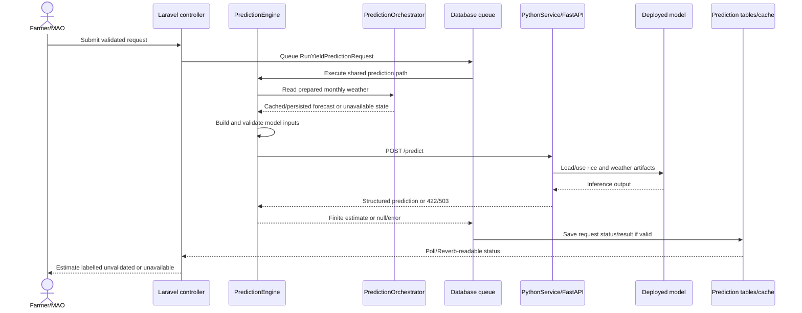

### 6.2 Deployed feature contract

The confirmed runtime column order is:

`RAINFALL`, `TEMP_AVG`, `TEMP_RANGE`, `Area`, `Previous_Rainfall`,
`Previous_Temp`, `Rainfall_6M`, `Temp_3M`, `Temp_6M`, `Seasonal_Rainfall`,
`Seasonal_Temp`, `Season`.

Laravel’s `PredictionEngine::REQUIRED_MODEL_INPUTS` also requires weather-only
values (`previous_humidity`, `previous_wind_speed`, `month_num`) because the
combined API computes the companion weather prediction. The Phase 14–15
runtime checks reject missing values, nonnumeric values, non-finite values,
`-999`, invalid seasons, and invalid months. The API returns HTTP 422 for
validly encoded invalid requests.

### 6.3 Scientific limitations

| Issue | Code evidence | Requirement status |
|---|---|---|
| Training dataset unavailable | Phase 10–16 reports and evidence inventory | Unverified; researcher delivery required |
| Preprocessing and units unavailable | `FeatureCatalog.php`, validation reports, no original training package | Unverified; do not infer transformations |
| `Area` target scale unresolved | Production accepts farm/municipal area while model target scope is undocumented | Compatibility blocked |
| `Rainfall_6M` definition unresolved | Production computes application rolling sum; original aggregation is not evidenced | Compatibility blocked |
| `TEMP_RANGE` definition unresolved | Production derives a monthly spread; original daily/monthly definition is not evidenced | Compatibility blocked |
| Climate freshness | `Ambulong Monthly Data.csv` is historical station data and readiness gate reports stale history for current target | Fresh Lian evidence required |
| Independent accuracy | No approved independent yield observations and leakage-safe protocol | Accuracy blocked |
| Confidence | Weather/decision-support confidence is heuristic and not rice-yield accuracy | Must not be presented as measured probability |

The deployed model is operationally usable only as an **unvalidated estimate**
under the current evidence boundary. A valid numeric inference is not evidence
of farm-specific scientific reliability.

## 7. Data model and persistence

The migration set implements users and account support, farmer profiles, farms
and boundaries, MAO coverage, climate and production records, planting
schedules, prediction requests and saved estimates, monthly weather, heat-map
data, advisories, notifications, reports, analytics runs, conversations and
messages, AI knowledge/moderation, backups, system logs, queue tables, and
model registry metadata. Important provenance fields include validation status,
verification timestamps, demo/derived classification, source fields, model
version, prediction timestamps, and unavailable reasons.

### 7.1 ERD (core implemented relationships)

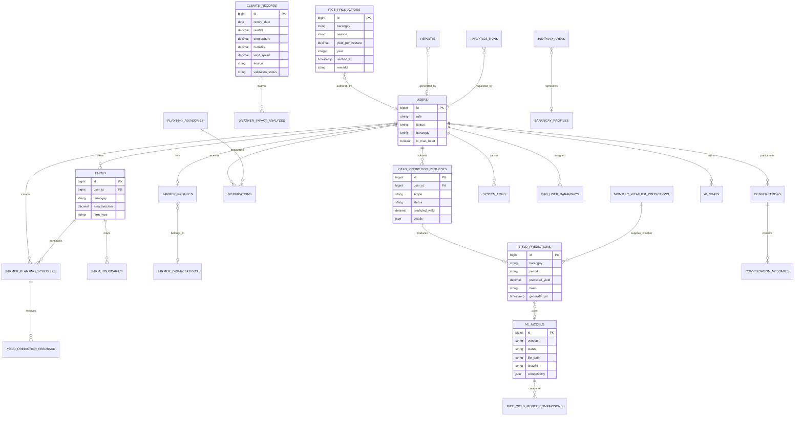

This is a core-domain ERD, not a claim that every auxiliary table is shown.
Queue, cache, failed-job, backup, feed, moderation, survey, feedback, and
variety tables are implemented but omitted from the diagram for readability.

## 8. Functional requirements

The following requirements distinguish current behavior from thesis-level
requirements that still need stakeholder confirmation.

### 8.1 Implemented functional requirements

| ID | Requirement |
|---|---|
| FR-I01 | The system shall authenticate users and enforce email/password, verification, throttle, and account-status rules. |
| FR-I02 | The system shall support Farmer, MAO Personnel, and IT Expert roles. |
| FR-I03 | The system shall route each role to its permitted dashboard and deny unauthorized role routes. |
| FR-F01 | A Farmer shall manage profile, farm, area, barangay, boundary, planting schedule, harvest, prediction history, feedback, advisories, and reports within ownership scope. |
| FR-M01 | MAO Personnel shall approve/reject farmers and manage assigned or municipality-wide agricultural records according to MAO scope. |
| FR-M02 | MAO Personnel shall import, validate, unvalidate, review, and report climate and rice-production records through protected workflows. |
| FR-M03 | MAO Personnel shall request barangay or municipal forecasts and view provenance-labeled actual/derived/unverified records. |
| FR-A01 | IT Expert shall inspect system health, operational pipeline, logs, resources, users, backups, and model metadata. |
| FR-A02 | IT Expert shall perform guarded model registry lifecycle actions subject to compatibility and approval gates. |
| FR-C01 | The system shall persist predictions, requests, statuses, timestamps, model metadata, and unavailable/error reasons where the relevant schema exists. |
| FR-C02 | The system shall use queued jobs for long-running predictions, analytics, refreshes, and notifications. |
| FR-W01 | The system shall obtain, normalize, cache, label, and display current/daily/monthly weather with source/freshness states. |
| FR-R01 | The system shall provide weather, flood, drought, and yield risk/heat-map views with role and barangay authorization. |
| FR-R02 | The system shall distinguish verified observations, unverified records, derived allocations, demo records, and model estimates. |
| FR-P01 | The system shall validate prediction inputs and return an explicit unavailable/error state rather than inventing missing values. |
| FR-P02 | The system shall call the deployed Python model through the shared Laravel prediction path and accept only finite numeric output. |
| FR-P03 | The system shall label rice-yield outputs as unvalidated and preserve `ACCURACY NOT VERIFIED`. |
| FR-N01 | The system shall publish role-scoped advisories and notifications and support read/unread state. |
| FR-T01 | The system shall broadcast authorized invalidation events and provide polling/fallback behavior when realtime delivery fails. |
| FR-O01 | The system shall provide backup, restore-test, maintenance, and operational audit functions without silently overwriting active data. |

### 8.2 Proposed or stakeholder-dependent requirements

| ID | Requirement needing approval |
|---|---|
| FR-X01 | Define whether the rice-yield target is farm-level, barangay-level, municipal, or seasonal aggregate. |
| FR-X02 | Approve authoritative agricultural sources, verification workflow, duplicate policy, and minimum independent sample/group count. |
| FR-X03 | Supply and approve the original 12-feature dictionary, units, transformations, missing-value rules, and target construction. |
| FR-X04 | Approve chronological or season-grouped evaluation protocol and baseline acceptance thresholds. |
| FR-X05 | Approve whether unsupported farm-specific numeric estimates should be suppressed entirely or remain visible as unvalidated historical estimates. |
| FR-X06 | Define and approve weather forecast horizons and acceptable Lian-versus-Ambulong source use. |
| FR-X07 | Define Heat Map risk methodology, verified-yield minimums, and behavior when measured data is unavailable. |
| FR-X08 | Define data retention, export, correction, deletion, and consent policies for farmer records and AI conversations. |
| FR-X09 | Define operational SLOs, backup RPO/RTO, incident response, and production deployment ownership. |

## 9. Non-functional requirements

| ID | Requirement | Evidence/status |
|---|---|---|
| NFR-01 Security | Authentication, verification, role middleware, throttles, private-channel authorization, generic error messages, and audit logs shall protect access and reduce disclosure. | Implemented and tested; security review remains recommended |
| NFR-02 Integrity | System shall preserve database relationships, validation state, provenance, timestamps, and model checksums. | Implemented; source-data governance needs approval |
| NFR-03 Availability | Web, ML, queue, scheduler, Reverb and DB health shall be observable; failed integrations shall degrade to explicit unavailable states. | Implemented and regression-tested |
| NFR-04 Performance | Cache prepared dashboards and forecasts; use queues for long work; avoid training on normal page requests. | Implemented; production SLO not specified |
| NFR-05 Reproducibility | Prediction inputs, model version, checksums, timestamps, and evaluation artifacts shall be retained. | Partially implemented; original training provenance missing |
| NFR-06 Scientific honesty | Do not claim accuracy without independent verified evidence; distinguish estimate, weather confidence, and measured metrics. | Implemented safeguards; research evidence missing |
| NFR-07 Maintainability | Shared PredictionEngine, centralized services, tests, readiness gates, and explicit contracts shall prevent divergent prediction paths. | Implemented |
| NFR-08 Accessibility/localization | Farmer-language middleware, responsive pages, plain-language UI, labels, and status messages shall support intended users. | Implemented in tested surfaces; full accessibility audit not evidenced |
| NFR-09 Auditability | Administrative, validation, model, prediction and operational changes shall be attributable and timestamped. | Implemented in many workflows; completeness should be confirmed by stakeholders |
| NFR-10 Recovery | Backups, restore tests, queue recovery, retry broadcasting, and service supervisor behavior shall support safe recovery. | Implemented/tested; RPO/RTO targets not defined |

## 10. Input–Process–Output models

### 10.1 Farmer IPO

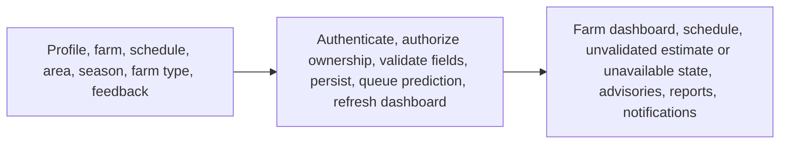

### 10.2 MAO IPO

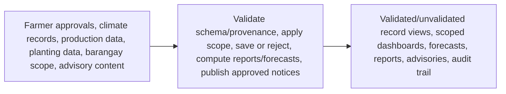

### 10.3 IT IPO

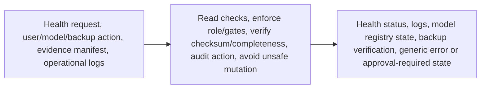

### 10.4 ML IPO

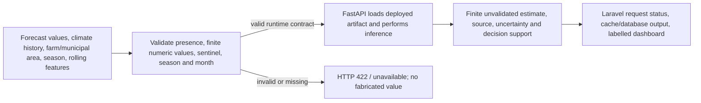

## 11. Data-flow diagrams

### 11.1 Context diagram

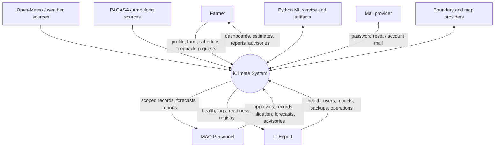

### 11.2 DFD Level 0

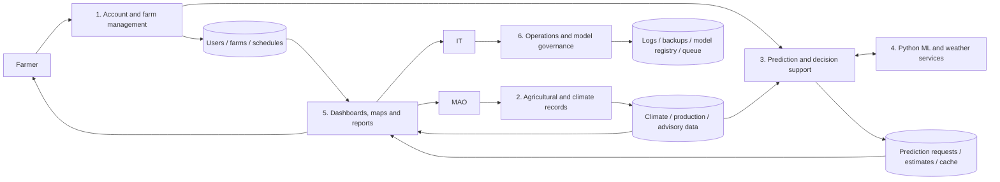

### 11.3 DFD Level 1 — prediction and evidence workflow

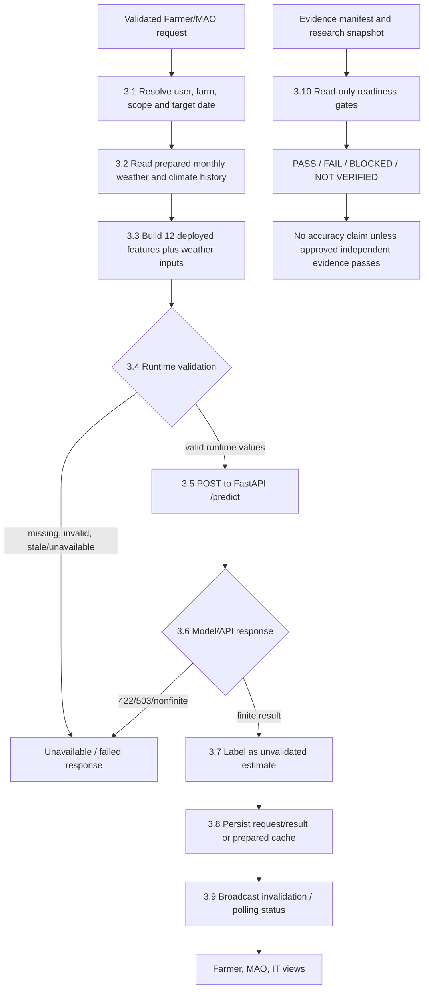

## 12. Use cases

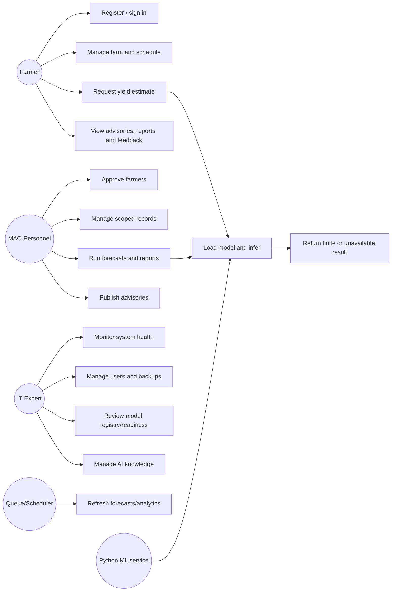

## 13. Missing, incomplete, and unverified requirements

### 13.1 Evidence-dependent blockers

1. Original rice-yield training dataset, code, preprocessing, feature
   dictionary, target definition, and split methodology.
2. Verified MAO production observations with source documents, observation
   identifiers, planting/harvest dates, units, and approval status.
3. Independent yield observations not duplicated, derived, demo-seeded, or
   used for training/tuning.
4. Current Lian-specific climate observations and an approved treatment of the
   Ambulong station proxy.
5. Researcher approval of farm-level versus municipal prediction scope.
6. Approved minimum independent sample/group count and chronological or
   season-grouped evaluation protocol.
7. Approved Heat Map yield/risk methodology when verified observations are
   absent.
8. Stakeholder decisions on whether unsupported farm-specific output remains a
   labelled estimate or is suppressed.

### 13.2 Technical requirements not fully evidenced by source

- Production SLOs, RPO/RTO, incident escalation and on-call ownership.
- Complete accessibility conformance audit.
- Formal privacy/consent/retention policy for farmer and AI-conversation data.
- Formal audit-log retention and export policy.
- Production external-provider contracts and data licensing.
- Full deployment topology and secret-management evidence.

## 14. Stakeholder validation checklist

Before thesis claims or model correction, obtain written approval for:

- actor/role definitions and MAO coverage semantics;
- farm, barangay, municipal and seasonal target units;
- climate sources, station geography, weather windows and freshness limits;
- every deployed feature’s unit and transformation;
- record verification, duplicate, demo, derived and correction policies;
- accuracy metrics, baselines, independent groups and leakage controls;
- Heat Map risk inputs and interpretation;
- what users may do with an unvalidated estimate;
- operational backup, recovery, privacy and retention targets.

## 15. Verification conclusion

The repository supports a functioning role-based agricultural information
system with guarded prediction integration, explicit error handling, queued and
cached workflows, role-scoped realtime updates, and broad regression coverage.
The implementation does not support a scientifically verified claim about the
deployed rice-yield model. No application code, database, model, prediction,
or running service was modified during Phase 17.

The correct next action is stakeholder and researcher evidence collection, not
another software audit or an unapproved model correction.
