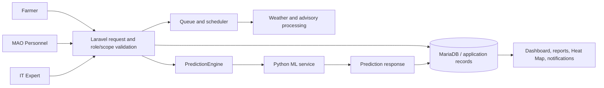

# Workflow and Model Consistency Review

## 1. Role and permission consistency

The Phase 17 workflow and access documents are consistent with the stored role model when the terminology is normalized:

| Documentation term | Implemented meaning | Validation result |
|---|---|---|
| Farmer | `role = Farmer`; own-record scope | Consistent |
| MAO Personnel | `role = MAO Personnel`; assigned barangay scope | Consistent |
| MAO Head / Municipal Agriculturist | MAO role plus `is_mao_head = true`; municipality-wide scope | Consistent; not a fourth stored role |
| Admin | Not a stored role; administrative actor is IT Expert | Must be corrected wherever used as a role |
| IT Expert | `role = IT Expert`; system administration | Consistent |

The route, middleware, policy, and private-channel descriptions align at a high level. The reports discrepancy remains: some prior manuscript wording assigns reports to IT, while `RedirectItFromFieldPages` redirects IT from `reports.*`. The final manuscript should describe reports as MAO functionality unless implementation scope is intentionally changed in a future approved task.

## 2. Workflow consistency

The Phase 17 Actor → Input → Validation → Process → Database → Output model is consistent for the main flows:

The non-human actors—scheduler, queue worker, Python service, Open-Meteo/PAGASA and other providers—must remain explicit in diagrams. They are not human permissions and should not be listed as user roles.

## 3. DFD, use-case, and IPO consistency

- Context and DFD diagrams correctly place Farmers, MAO, IT, external weather/climate providers, Python ML, queue/scheduler, and the database around Laravel.
- Level 1 flows correspond to authentication, farm/production, weather/risk, yield prediction, advisories, reports, and administration.
- Use cases should label “Municipal Agriculturist” as a specialization of MAO Personnel, not as an independent account role.
- IPO models correctly distinguish input validation and storage from output display; scientific outputs require the explicit unvalidated status.
- ERD descriptions should preserve provenance and distinguish raw observations, derived values, demo records, and predictions.

## 4. Reconciled ambiguities requiring stakeholder decisions

1. **Season:** `RiceSeason` and MAO summaries use different dry/wet season conventions. Approve one calendar and cross-year rule.
2. **Prediction target:** distinguish farm-level estimate, municipal total, and yield per hectare.
3. **Climate geography:** Ambulong station observations must not be presented as Lian-specific observations without an approved applicability statement.
4. **Advisory thresholds:** rule-based and Python advisory paths contain different thresholds; MAO must approve the authoritative rule set.
5. **Heat Map:** distinguish weather risk, flood/drought risk, and yield-derived layers; each needs its own provenance and no-data behavior.
6. **Reports:** resolve the manuscript claim that IT generates reports versus the implemented IT redirect.
7. **Retired/hidden features:** decide whether any are in final thesis scope; do not describe them as active without a feature flag and verification.

## 5. ML and Heat Map acceptance checklist

Before the corresponding requirement changes to verified, confirm:

- original training artifact, checksum, dataset, scripts, feature dictionary, units, transformations, and missing-value handling;
- exact compatibility of `Area`, `Rainfall_6M`, `TEMP_RANGE`, season encoding, and climate-history windows;
- approved target geography and crop/season alignment;
- independent, provenance-verified observations with duplicates, demo rows, derived rows, and training overlaps excluded;
- chronological or season-grouped split with no leakage;
- mean and seasonal baselines plus MAE, RMSE, R², bias, sample/group counts and limitations;
- Heat Map source, spatial aggregation, freshness, weights/thresholds, uncertainty, and absence behavior;
- written approval by the relevant MAO authority and researchers.

Until then, every diagram and requirement that mentions model quality or yield risk must retain **ACCURACY NOT VERIFIED**.

## 6. Traceability decision

No application code was modified in Phase 18. The Phase 17 traceability documents remain the implementation baseline; this review adds validation status and stakeholder decision points without asserting acceptance. A future approved update should add response identifiers and evidence links to the matrix after questionnaires are completed.
