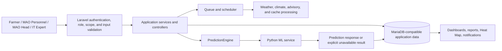

# iClimate Requirements Analysis — Final Thesis Draft

## Abstract

iClimate is a role-based web application for climate-informed rice-production decision support in Lian, Batangas. The implemented system provides Farmer, MAO Personnel, MAO Head, and IT Expert workflows through Laravel, MariaDB-compatible persistence, scheduled and queued processing, external weather/climate integrations, a Python machine-learning service, and dashboard/report interfaces. This requirements analysis describes implemented behavior separately from requirements that remain subject to stakeholder approval or scientific evidence.

The system can generate operational estimates and risk-oriented displays, but the deployed rice-yield model has not been independently validated. Accordingly, this document preserves **ACCURACY NOT VERIFIED** and does not claim model accuracy.

## 1. Scope and analysis basis

The analysis was based on the Phase 17 system analysis, Phase 18 validation artifacts, Laravel routes/controllers/services/models, Python ML service, migrations, tests, and recorded readiness results. Requirements are classified as:

- **Implemented:** a corresponding source-code path exists.
- **Technically verified:** implementation is supported by tests or recorded runtime evidence.
- **Operational but scientifically unverified:** the system produces an output, but agricultural validity or model accuracy is not established.
- **Incomplete:** behavior or documentation is partial, conflicting, or unavailable.
- **Pending approval:** a stakeholder must define or accept the requirement.
- **Blocked:** required research evidence or an external dependency is absent.

## 2. Actors and permissions

The persisted roles are Farmer, MAO Personnel, and IT Expert. The Municipal Agriculturist is implemented as MAO Personnel with `is_mao_head = true`, which provides municipality-wide MAO coverage and personnel-management authority where implemented. A Visitor can access public pages and registration. Scheduler, queue worker, external providers, and the Python ML service are system actors.

Authentication, account status, role middleware, module-access checks, ownership queries, MAO barangay scope, policies, and private broadcast channels form the access-control chain. Farmers operate on their own records; MAO Personnel operate within assigned barangays, with a read-only municipal view where available; MAO Head scope is municipality-wide; IT Expert manages technical administration and system health.

## 3. Functional requirements

### 3.1 Account and access

The system shall authenticate active accounts, enforce account status, restrict routes by role, protect user-owned and barangay-scoped records, support Farmer registration and MAO approval, and audit significant account actions. These functions are implemented and technically supported by authentication, authorization, registration, approval, and audit tests.

### 3.2 Farmer services

The system shall allow a Farmer to manage owned farms, locations, planting schedules, rice varieties, harvest records, reports, advisories, messages, notifications, surveys, and prediction requests. The system shall label estimates as unvalidated and shall not present unsupported accuracy percentages. The workflow is implemented; the agricultural validity of submitted records and estimates remains unverified.

### 3.3 MAO services

The system shall allow MAO Personnel to review Farmer accounts, manage scoped farmer and production records, view weather/risk information, manage advisories and alerts, inspect reports, and use planning and analysis functions. The MAO Head shall manage MAO personnel and assignments where the implementation permits. These are implemented workflows; authoritative data sources, thresholds, and publication policies require MAO approval.

### 3.4 IT Expert services

The system shall allow the IT Expert to manage accounts, settings, module permissions, backups, maintenance records, system health, system logs, model metadata, and guarded model-management functions. `admin.*` route names are not a separate role definition. Reports are implemented as MAO-facing functionality; the current IT redirection from `reports.*` is a documented scope limitation.

### 3.5 Climate, risk, advisories, and reporting

The system shall acquire and display current/forecast weather, store climate and production records, calculate rule-based risk displays, generate and publish advisories, deliver notifications, and generate authorized reports. These paths exist and are test-covered to varying degrees. Their domain thresholds, spatial assumptions, freshness requirements, and scientific interpretation remain subject to stakeholder approval.

### 3.6 Prediction boundary

Laravel validates and constructs the model request, the prediction orchestration path calls the Python service, and the service returns an estimate or an explicit unavailable/error result. The model schema and input rejection safeguards are technically verified. The original training definitions for all twelve rice-yield features are not available, so compatibility and accuracy are not established.

## 4. Non-functional requirements

The implementation provides role authorization, private channels, audit logging, explicit degradation, backup tooling, health checks, queued processing, cache preparation, localization support, and model metadata/checksum handling. The following still require acceptance criteria and evidence: availability targets, response-time/load targets, supported browsers/devices, accessibility evaluation, off-server backup and restore objectives, log retention, privacy/retention policy, and incident recovery objectives.

## 5. Integrated IPO model

| Actor/input | Validation and process | Persistence | Output |
|---|---|---|---|
| Farmer account, farm, schedule, harvest, feedback | Request validation, ownership checks, conversions, audit | Users, farms, schedules, production, feedback | Farmer dashboard, calendar, advisories, reports, estimates |
| MAO climate/production records and approvals | Scope, provenance, date/unit/duplicate checks, domain review | Climate, production, advisories, activity logs | MAO dashboards, analyses, reports, published advisories |
| IT settings, account, backup, and model actions | Role, policy, token, readiness, checksum, audit checks | Settings, logs, backups, model metadata | Health, maintenance, registry, audit and recovery outputs |
| Weather/climate provider data and schedule triggers | Provider response, freshness, unit and coverage checks | Weather, climate, risk and cache records | Weather, risk layers, notifications, downstream inputs |
| Approved model request | 12-feature schema, finite numeric values, season/month bounds, missing-input rejection | Prediction request/result metadata | Estimate or explicit unavailable response; never a verified accuracy claim |

## 6. Workflow and diagram alignment

The canonical flow is:

The DFDs, use cases, and IPOs should use the canonical actor labels above. Use cases may show MAO Head as a specialized MAO actor, but not as a separate persisted role. External providers and automated workers should be represented as non-human actors. Risk and yield layers must be distinguished from verified observations.

## 7. Research and stakeholder limitations

The following cannot be finalized from code alone: prediction target geography; yield definition; season and crop-weather matching; authoritative MAO sources; advisory thresholds; Heat Map methodology; model feature semantics; independent evaluation design; minimum samples; evidence exclusion rules; security and operational policies. These are tracked in the Phase 19 matrix and templates.

## 8. Scientific integrity statement

No accuracy value, R², MAE, RMSE, bias, or scientific claim is made here. Demo, derived, duplicated, training, and unverified observations must not be used as independent validation evidence. The deployed model, model weights, prediction formulas, and active records remain unchanged. The current status is **ACCURACY NOT VERIFIED**.

## 9. Thesis acceptance recommendation

This draft is suitable as an implementation-grounded requirements chapter after stakeholder responses are attached and the pending policy decisions are resolved. It is not sufficient as a scientific model-evaluation chapter. A separate approved evaluation package is required before the thesis reports model performance or validates the Heat Map methodology.
